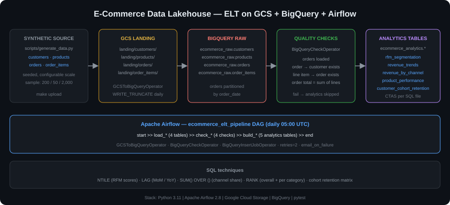

# E-Commerce Data Lakehouse


End-to-end e-commerce ELT pipeline on synthetic data: generated CSVs → GCS → BigQuery raw layer → data-quality checks → analytics tables. Covers RFM customer segmentation, monthly/YoY revenue trends, channel mix, product performance ranking, and cohort retention, all orchestrated by Apache Airflow.

## Architecture



## Pipeline Overview

```
generate_data.py  (seeded; sample in data/ = 200 customers, 50 products, 2,000 orders)
   └── GCS landing zone  (landing/<table>/<table>.csv)
         └── Airflow GCSToBigQueryOperator
               └── BigQuery ecommerce_raw  (customers, products, orders, order_items)
                     └── Quality checks  (rows loaded, every order has a customer,
                     │                    every line has an order, order total = sum of lines)
                     └── Analytics SQL → ecommerce_analytics tables
                         (rfm_segmentation, revenue_trends, revenue_by_channel,
                          product_performance, customer_cohort_retention)
```

## Project Structure

```
ecommerce-data-lakehouse/
├── scripts/
│   └── generate_data.py         # Synthetic data generator (configurable scale, seeded)
├── airflow/
│   └── dags/ecommerce_elt_dag.py  # load -> BigQueryCheckOperator checks -> CTAS per SQL file
├── sql/
│   ├── schema/
│   │   └── 01_create_raw_tables.sql   # raw tables + analytics dataset
│   └── analytics/
│       ├── rfm_segmentation.sql         # NTILE-based RFM scoring + segments
│       ├── revenue_trends.sql           # MoM + YoY revenue with LAG
│       ├── revenue_by_channel.sql       # channel revenue + share of total
│       ├── product_performance.sql      # RANK overall and within category + margin
│       └── customer_cohort_retention.sql
├── tests/
│   └── test_generate_data.py     # referential integrity, totals, dates, determinism
├── data/                         # Sample CSV files (generated with `make data`)
│   ├── customers.csv
│   ├── products.csv
│   ├── orders.csv
│   └── order_items.csv
├── snapshots/
│   └── architecture.svg
├── .env.example
└── requirements.txt
```

## Analytics Queries

**RFM Segmentation** (`sql/analytics/rfm_segmentation.sql`)
Scores every customer 1–4 on Recency, Frequency, and Monetary value using `NTILE(4)` window functions, then classifies them into segments: Champions, Loyal Customers, At Risk, Hibernating, Lost, etc.

**Revenue Trends** (`sql/analytics/revenue_trends.sql`)
Monthly revenue with month-over-month and year-over-year growth using `LAG()`. `revenue_by_channel.sql` adds the channel breakdown with a `SUM() OVER ()` share percentage.

**Product Performance** (`sql/analytics/product_performance.sql`)
Units sold, total revenue, gross profit, and margin per product. `RANK()` within each category to identify top performers.

**Cohort Retention** (`sql/analytics/customer_cohort_retention.sql`)
Monthly signup cohorts tracked through 12 months of purchase activity. Outputs a retention matrix: % of each cohort (all active customers who signed up that month) purchasing in each month after signup.

## Quick Start

```bash
# 1. Install
git clone https://github.com/jaiminbabariya7/ecommerce-data-lakehouse.git
cd ecommerce-data-lakehouse && pip install -r requirements.txt
cp .env.example .env && set -a && . ./.env && set +a

# 2. Use the sample in data/ or generate a bigger dataset
python scripts/generate_data.py --customers 5000 --orders 50000 --out data/

# 3. Upload to the GCS landing zone (landing/<table>/<table>.csv)
make upload

# 4. Create the raw tables and the analytics dataset
sed "s/PROJECT_ID/$GCP_PROJECT_ID/g" sql/schema/01_create_raw_tables.sql | bq query --use_legacy_sql=false

# 5. Run the Airflow DAG (load -> quality checks -> analytics tables)
#    The DAG reads the SQL files from $SQL_DIR (default /opt/airflow/sql/analytics)
airflow dags trigger ecommerce_elt_pipeline

# 6. Run the tests
make test
```

## Tech Stack

| Component | Technology |
|---|---|
| Orchestration | Apache Airflow 2.8 |
| Storage | Google Cloud Storage |
| Data Warehouse | Google BigQuery |
| Language | Python 3.11 |
| Analytics | BigQuery SQL (window functions, CTEs) |
| Data Modelling | Relational raw schema (customers, products, orders, order_items) + materialised analytics tables |
| Testing | pytest (generator) + BigQueryCheckOperator data-quality checks |